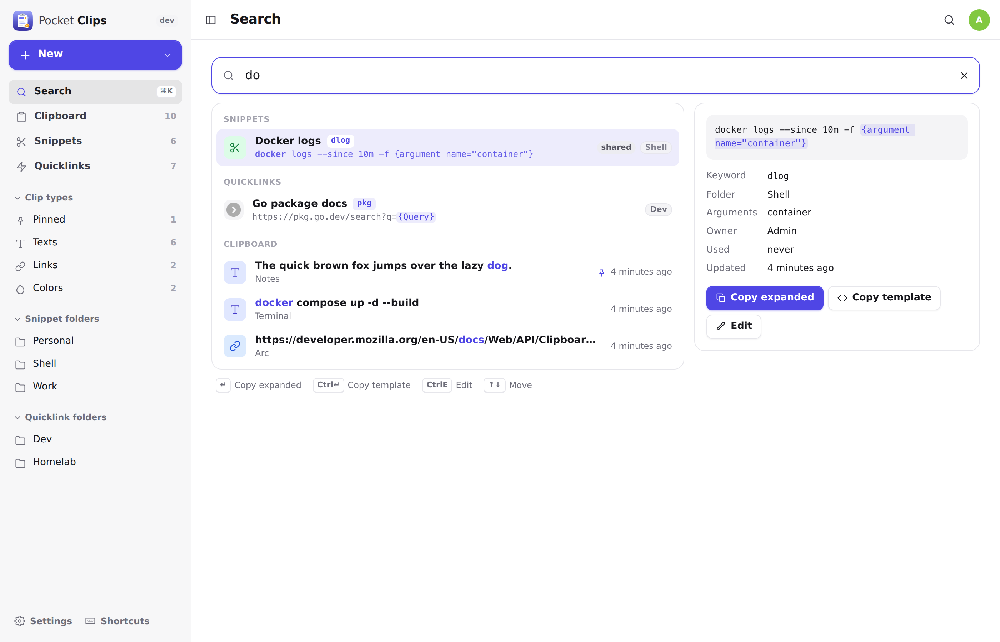
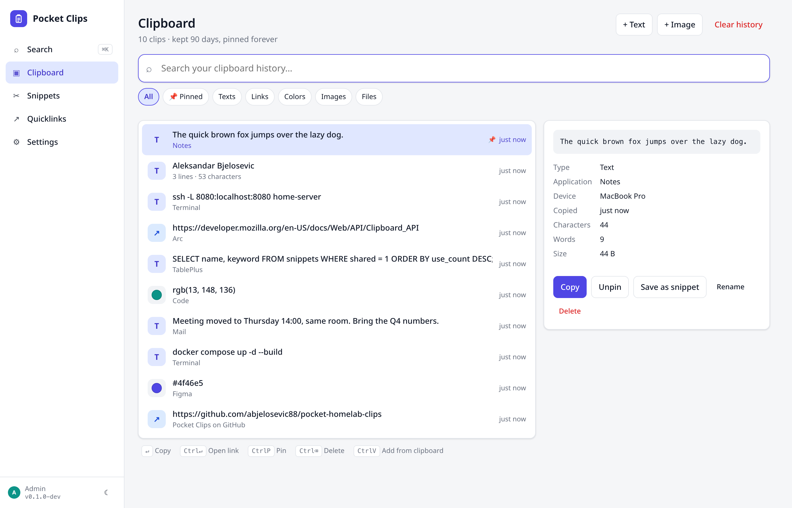
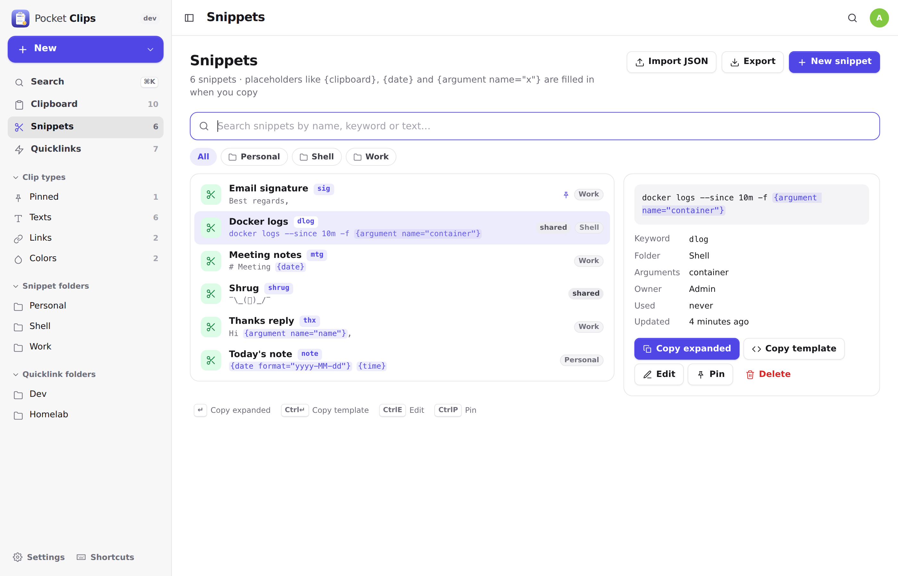
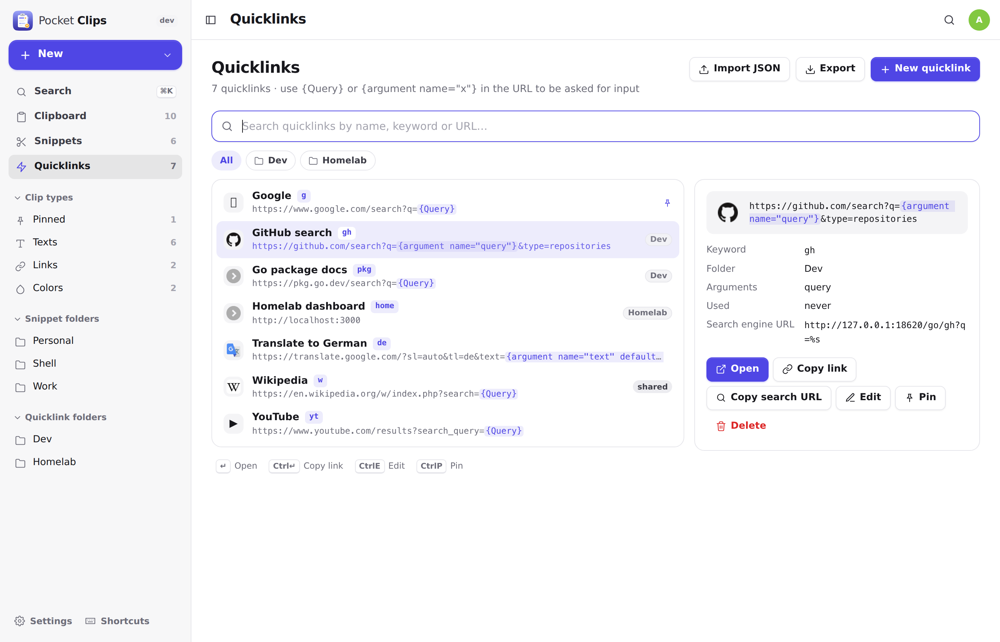
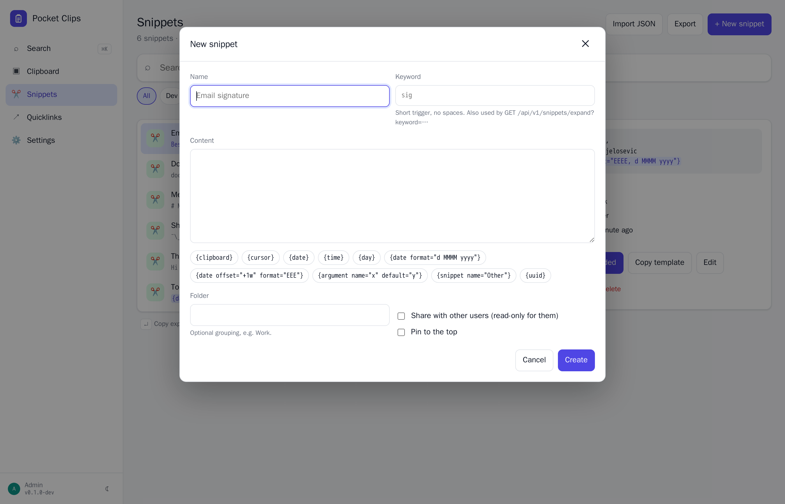
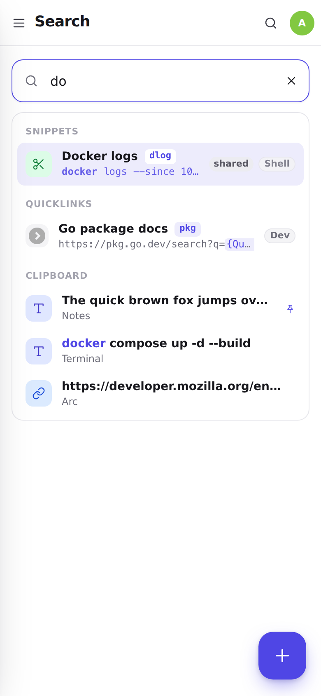
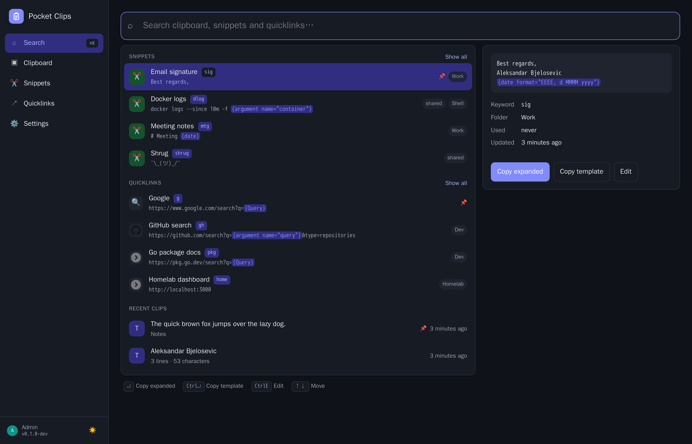

<p align="center">
  
</p>
<h1 align="center">Pocket Clips</h1>
<p align="center">
  Clipboard history, snippets and quicklinks as a small self-hosted server, searchable from every device.<br>
  <b>One binary · one SQLite file · one volume.</b>
</p>
<p align="center">
  <a href="https://github.com/abjelosevic88/pocket-homelab-clips/actions"></a>
  <a href="https://github.com/abjelosevic88/pocket-homelab-clips/pkgs/container/pocket-homelab-clips"></a>
  <a href="LICENSE"></a>
</p>

---

The three things I reach for most often — what I copied, the text I keep retyping, and the searches I run a hundred times a day — usually live in one app on one machine. This puts them in a Go binary on your own server, so the history survives a reinstall, the iPhone can read it, and a snippet written on the laptop expands on the desktop. Built around four things:

- **A clipboard history that is actually searchable.** Every copy from every connected device lands in one list: text, links (with the page title looked up), colours (with a swatch), images. Copying the same thing twice moves it to the top instead of adding a duplicate. SQLite FTS5 does the finding: `inv num` finds *Invoice number 2026-001*, `ample` finds *Example*, and `#` finds your colours. Pin what matters; the rest expires on a schedule you set.
- **Snippets with dynamic placeholders.** `{clipboard}`, `{date offset="+1w" format="EEEE"}`, `{argument name="name"}`, `{snippet name="Signature"}`, `{cursor}`, `{uuid}` — expanded on the server, so `curl …/snippets/expand?keyword=sig | pbcopy` works from any shell and the web UI asks for arguments before copying.
- **Quicklinks that take a query.** `https://github.com/search?q={Query}` opens with what you type; a keyword makes it `/go/gh?q=…`, which any browser accepts as a custom search engine. Favicons come along.
- **One search box over all of it.** `⌘K`, type, `↑↓`, `↵`. Results come in sections with a detail pane that shows the source app, device, when, how often, characters, words, size.

Everything is yours per user (clips always; snippets and quicklinks unless you share them), with login, SSO-proxy or no-auth modes, API tokens per device, and JSON import/export.

<p align="center"></p>

<table>
  <tr>
    <td width="50%"></td>
    <td width="50%"></td>
  </tr>
  <tr>
    <td align="center"><sub>Clipboard history: texts, links, colours, images; pin, rename, save as snippet.</sub></td>
    <td align="center"><sub>Snippets: keyword, folder, placeholders tinted, shared ones marked.</sub></td>
  </tr>
  <tr>
    <td width="50%"></td>
    <td width="50%"></td>
  </tr>
  <tr>
    <td align="center"><sub>Quicklinks: favicon, keyword, arguments, the URL for your browser's search engines.</sub></td>
    <td align="center"><sub>Editing a snippet: chips insert placeholders at the cursor.</sub></td>
  </tr>
</table>

<p align="center">
  &nbsp;&nbsp;
  <br>
  <sub>Installable PWA with a bottom tab bar, plus dark mode.</sub>
</p>

## Features

| Area | What you get |
|---|---|
| **Clipboard** | Text, link, colour, image and file clips with source app and device. Dedupe with copy count, pin, rename, clear by type, retention (1 week … forever) and a per-user cap, link titles fetched in the background. Paste anywhere on the page to add. |
| **Search** | FTS5 over content, titles and app names with BM25 ranking, word-prefix matching, substring and symbol fallback, highlighted passages. One endpoint for everything or one per type. Keyboard first: `⌘K`, `↑↓`, `↵`, `⌘↵`, `⌘P`, `⌘⌫`. |
| **Snippets** | Name, keyword, folder, pin, share. Placeholders: `{clipboard}` `{selection}` `{cursor}` `{date}` `{time}` `{datetime}` `{day}` with `format=` and `offset=`, `{argument name= default=}`, `{snippet name=}`, `{uuid}`. Server-side expansion with argument prompts, live preview in the editor, use counts. |
| **Quicklinks** | Name, link with `{Query}` / `{argument}` / `{clipboard}`, keyword, emoji or favicon, "open with", folder, pin, share. `/go/<keyword>?q=` redirect for browser search engines. |
| **Users** | Built-in login (admin/member), or trust your SSO proxy's header, or no login on a trusted LAN. Per-device API tokens. Shared snippets and quicklinks are read-only for others, with "Duplicate to mine". |
| **Clients** | Watcher scripts for macOS (pbpaste + pngpaste), Linux (wl-clipboard / clipnotify), iOS Shortcut and PowerShell recipes. See [docs/clients.md](docs/clients.md). |
| **Data** | SQLite backup from the UI/CLI/API, JSON export/import (whole library, or bare snippet and quicklink arrays), Prometheus `/metrics`, `GET /dashboard` for Homepage. |

## Run it

```bash
mkdir pocket-clips && cd pocket-clips
curl -fsSLO https://raw.githubusercontent.com/abjelosevic88/pocket-homelab-clips/main/docker-compose.yml
docker compose up -d
# open http://localhost:8080 and create your account
```

Or with plain Docker:

```bash
docker run -d --name pocket-clips -p 8080:8080 -v ./data:/data -e TZ=Europe/Berlin \
  ghcr.io/abjelosevic88/pocket-homelab-clips:latest
```

Want to look around first? Add `-e DEMO_DATA=true -e AUTH_MODE=none` to get sample clips, snippets and quicklinks with no login.

Binaries for Linux, macOS and Windows are attached to every [release](https://github.com/abjelosevic88/pocket-homelab-clips/releases), and a systemd unit is in [deploy/systemd](deploy/systemd).

Then connect a device: create a token under **Settings → API tokens** and start a watcher from [deploy/clients](deploy/clients) — or just paste into the Clipboard page.

## Configuration

Everything is an environment variable with a sensible default. The important ones:

| Variable | Default | Notes |
|---|---|---|
| `TZ` | `UTC` | What `{date}` and `{time}` expand to. Set it. |
| `BASE_URL` | – | Public URL (informational). |
| `DATA_DIR` | `/data` | Database, images and backups live here. |
| `AUTH_MODE` | `local` | `local` (built-in login, multi-user), `proxy` (trust `Remote-User` from your SSO proxy; users auto-created), `none` (single implicit user with no login, for a trusted LAN only). |
| `ADMIN_EMAIL` / `ADMIN_PASSWORD` | – | Create the first admin without the setup screen. |
| `SECURE_COOKIES` | `false` | Set `true` behind HTTPS. |
| `LINK_TITLES` | `true` | Look up the `<title>` of copied links. `false` = no outbound requests, ever. |
| `MAX_CLIP_BYTES` / `MAX_IMAGE_BYTES` | 2 MB / 20 MB | Size limits for a text / image clip. |
| `DEMO_DATA` | `false` | Seed sample data into an empty database. |

Retention and the per-user cap are set in the app (Settings → General). The full list is in [docs/configuration.md](docs/configuration.md), and reverse-proxy snippets are in [docs/reverse-proxy.md](docs/reverse-proxy.md).

## How it works

- **One row per distinct content per user.** A clip is keyed by a hash of its kind and content; copying it again updates `last_copied_at` and `copy_count`, so the list is always newest-first with no repeats and "times copied" is real.
- **FTS5 external-content tables** mirror `clips`, `snippets` and `quicklinks` through triggers, so the index never drifts and a search is one indexed query. Query words become prefix tokens (`"inv"* "num"*`); when that finds nothing — a symbol, a mid-word substring — the same query runs as `LIKE`. Pinned rows sort first, then BM25.
- **Placeholders are expanded on the server** so every client sees the same result: dates in the server's `TZ`, `{snippet}` nesting with a depth limit, arguments reported as `missing` when neither a value nor a default exists. Quicklinks percent-encode every value.
- **Images** are stored once by content hash under `DATA_DIR/images`; the database holds the file name and dimensions.
- **Retention** runs hourly: unpinned clips older than the period go, then the oldest unpinned beyond the cap.

## Automation

Create a token under **Settings → API tokens**, then:

```bash
# record a copy (kind is detected: this one becomes a link and gets its title)
echo "https://github.com/abjelosevic88/pocket-homelab-clips" | \
  curl -X POST "https://clips.example.com/api/v1/clips?source_app=Terminal" \
  -H "Authorization: Bearer pc_…" -H "Content-Type: text/plain" --data-binary @-

# expand a snippet into the clipboard
curl -fsS "https://clips.example.com/api/v1/snippets/expand?keyword=sig&arg.name=Ana" -H "Authorization: Bearer pc_…" | pbcopy

# search everything
curl -fsS "https://clips.example.com/api/v1/search?q=invoice" -H "Authorization: Bearer pc_…"

# open a quicklink from the address bar: keyword "gh", query "sqlite fts5"
open "https://clips.example.com/go/gh?q=sqlite+fts5"

# compact status for a Homepage / Glance widget
curl -H "Authorization: Bearer pc_…" https://clips.example.com/api/v1/dashboard
# → {"clips":1432,"clips_today":37,"pinned_clips":12,"snippets":41,"quicklinks":23,"last_clip_ago":"2m ago",…}
```

Everything else, including the Homepage `customapi` widget, is in [docs/api.md](docs/api.md).

## Importing an existing library

**Import JSON** takes a Pocket Clips export or a bare array of snippets (`[{name, text, keyword}]`) or quicklinks (`[{name, link, openWith}]`); the arrays are recognised by their fields. *Export* on the Snippets and Quicklinks pages gives you the same bare arrays back. The clipboard history starts with whatever the watchers record from the moment they run.

## Backups

The database is a single file.

- **UI:** Settings → Backup & data → *Download database* (a consistent `VACUUM INTO` copy).
- **CLI:** `docker exec pocket-clips pocket-clips backup` writes to `/data/backups/`.
- **API:** `GET /api/v1/backup`.
- **Export:** the library as JSON (snippets, quicklinks, optionally clips), re-importable.

Restic / Borg / Backrest users: back up `DATA_DIR`, but snapshot the live `pocket-clips.db` through one of the methods above rather than copying the WAL files raw. See [docs/backup.md](docs/backup.md).

## Development

```bash
make dev      # Go API on :8080 (demo data, no login) + Vite on :5173
make test     # go vet + go test + tsc
make all      # production build: web UI embedded into ./pocket-clips
```

Requires Go 1.22+ and Node 20+. Stack: Go + chi + modernc SQLite with FTS5 (no CGO), and React 19 + Vite + TypeScript with no UI framework. Planned next steps are in [docs/roadmap.md](docs/roadmap.md).

## Credits

Favicons are served by DuckDuckGo. Sibling projects built the same way are [Pocket Habits](https://github.com/abjelosevic88/pocket-homelab-habit-tracker), [Pocket Inventory](https://github.com/abjelosevic88/pocket-homelab-inventory), [Pocket Bookshelf](https://github.com/abjelosevic88/pocket-homelab-bookshelf), [Pocket Split](https://github.com/abjelosevic88/pocket-homelab-cost-split), [Pocket Subtitles](https://github.com/abjelosevic88/pocket-homelab-subtitles) and [Pocket Invoicing](https://github.com/abjelosevic88/pocket-homelab-invoicing).

## License

MIT
